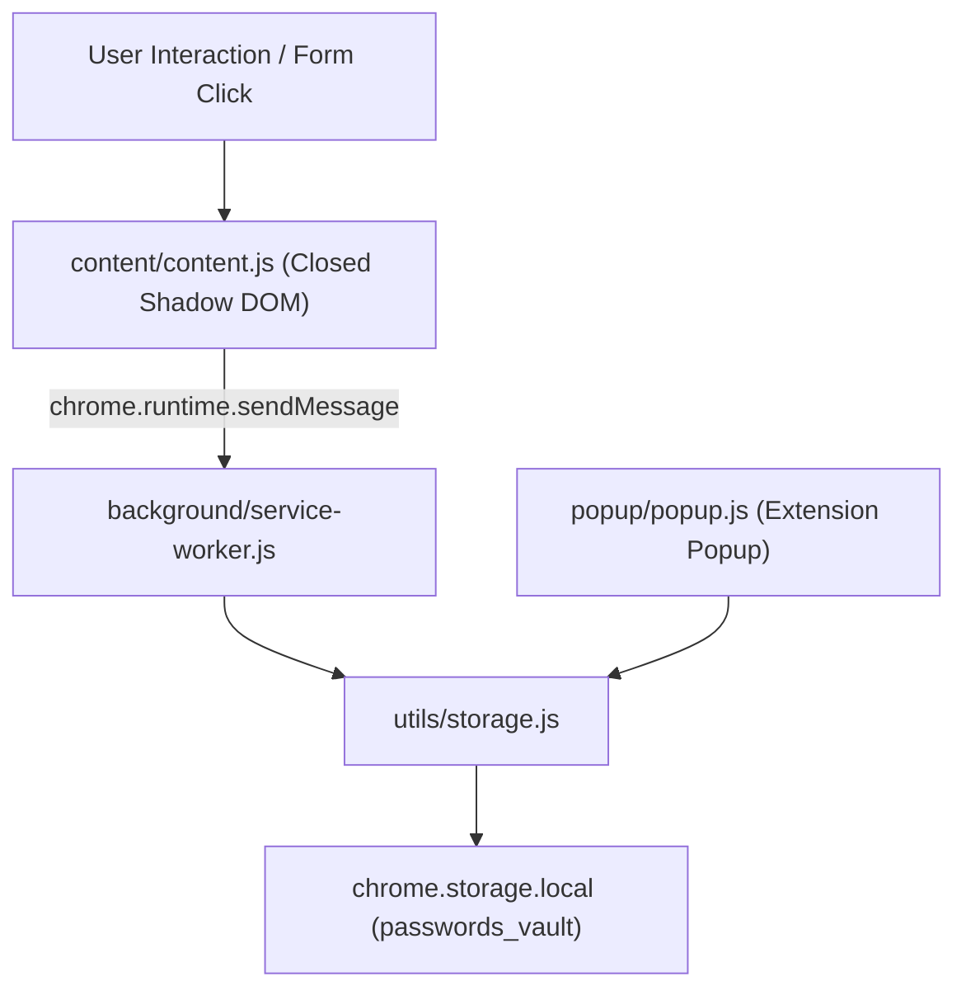

# Chrome Password Manager Wiki

Welcome to the **Chrome Password Manager** wiki! This documentation covers the architecture, setup, security model, and feature walkthrough for developers, system administrators, and contributors.

---

## 📑 Table of Contents

- [1. Overview & Problem Statement](#overview--problem-statement)
- [2. Installation & Quickstart](#installation--quickstart)
- [3. Architecture & Manifest V3 Design](#architecture--manifest-v3-design)
- [4. In-Page Autofill & Closed Shadow DOM](#in-page-autofill--closed-shadow-dom)
- [5. Vault Management, Search & Editing](#vault-management-search--editing)
- [6. Cryptography & Password Generation](#cryptography--password-generation)
- [7. Security Model & Hardening](#7-security-model--hardening)
- [8. Backup, Export & Migration](#8-backup-export--migration)

---

<a id="overview--problem-statement"></a>
## 1. Overview & Problem Statement

In modern Google Chrome, the native password manager **strictly suppresses password auto-suggestion and autofill dropdowns on unencrypted (`http://`) origins**, displaying warnings like *"Password form on an insecure (http://) page"*.

While this policy protects public web traffic, it causes constant friction for:
- **Developers & Engineers:** Working on local development servers (`http://localhost:3000`, `http://127.0.0.1:8000`, dev microservices).
- **Network & System Administrators:** Managing internal routers, switches, IoT web interfaces (`http://192.168.1.1`, firewall consoles).
- **Enterprise Users:** Accessing internal legacy tools or staging clusters without TLS/HTTPS certificates.

**Chrome Password Manager eliminates this limitation.** It provides a standalone, lightweight in-page credential picker and autofill manager that operates seamlessly across both `http://*` and `https://*` origins.

---

<a id="installation--quickstart"></a>
## 2. Installation & Quickstart

### Prerequisites
- Google Chrome, Brave, Edge, Arc, or any modern Chromium browser (Version 88+).

### Step-by-Step Installation
1. Clone the repository:
   ```bash
   git clone https://github.com/jazeel-zainudeen/chrome-password-manager.git
   ```
2. Open Chrome and navigate to:
   ```text
   chrome://extensions
   ```
3. Toggle the **Developer mode** switch in the top-right corner.
4. Click the **Load unpacked** button in the top-left corner.
5. Select the repository root folder containing `manifest.json`.
6. Pin **Password Manager** to your Chrome toolbar.

### Verifying with the Test Server
To immediately test unencrypted HTTP autofill:
```bash
cd test-page
python3 server.py
```
Open **[http://localhost:8899/index.html](http://localhost:8899/index.html)** in your browser:
- Click the **Username** or **Password** input field to see the in-page dropdown.
- Click **Fill** to autofill the demo credentials.
- Click **Sign In** to verify the save prompt!

---

<a id="architecture--manifest-v3-design"></a>
## 3. Architecture & Manifest V3 Design



### Component Breakdown
| File | Role |
| :--- | :--- |
| `manifest.json` | Manifest V3 configuration with minimal permissions (`storage`, `tabs`, `activeTab`). |
| `background/service-worker.js` | Background worker managing tab badge counters and in-memory pending save state. |
| `content/content.js` | Form detection, closed Shadow DOM picker injection, and synthetic event dispatching. |
| `popup/popup.js` | Full-featured Dark Mode vault manager, search engine, and editor. |
| `utils/storage.js` | Storage controller with multi-part PSL domain matching and URL parsing. |
| `utils/crypto.js` | CSPRNG password generator and strength evaluator. |

---

<a id="in-page-autofill--closed-shadow-dom"></a>
## 4. In-Page Autofill & Closed Shadow DOM

### Closed Shadow DOM Isolation
All extension UI elements (floating picker, inline field key icon, tooltips, and save prompts) are mounted inside:
```javascript
shadowRoot = containerEl.attachShadow({ mode: 'closed' });
```

**Benefits:**
- **Zero Host Script Leakage:** Page JavaScript cannot access `containerEl.shadowRoot` to inspect elements or sniff passwords.
- **Style Encapsulation:** Page CSS resets, Tailwind utilities, or Bootstrap overrides cannot alter or break the extension's UI.

### Smart Form & Field Mapping
The extension supports:
- Traditional `<form>` elements and modern AJAX-driven `div[role="form"]` structures.
- Multi-field PHP array field names (e.g., `auth[server]`, `auth[username]`, `auth[password]`).
- Synthetic event dispatching (`input`, `change`) to trigger state updates in React, Vue, and Angular forms.

---

<a id="vault-management-search--editing"></a>
## 5. Vault Management, Search & Editing

The extension popup provides full vault control:
- **Active Site Matching:** Instantly shows credentials matching the open tab's origin and hostname.
- **Search with Keyword Highlighting:** Filters through credentials with real-time `<mark>` query highlighting.
- **Credential Editor:** Edit usernames, passwords, and custom notes directly from the popup.
- **Password Reveal Masking:** Passwords remain masked as `••••••••` until the user explicitly toggles the visibility eye.

---

<a id="cryptography--password-generation"></a>
## 6. Cryptography & Password Generation

The generator in `utils/crypto.js` utilizes modern Web Crypto primitives:
- **Entropy Source:** `crypto.getRandomValues(uint32Buffer)` replaces insecure pseudo-random algorithms.
- **Fisher-Yates Shuffle:** Uses CSPRNG indices to avoid modulo and positional bias.
- **Strength Scoring:** Evaluates character set diversity, length, and entropy to classify passwords into 5 tiers (Very Weak to Very Strong).

---

<a id="security-model--hardening"></a>
## 7. Security Model & Hardening

The codebase was audited and hardened against modern browser attack vectors:
1. **No External Network Calls:** Operates 100% locally with zero cloud dependencies or telemetry.
2. **Untrusted Event Neutralization:** All primary trigger handlers verify `if (!e.isTrusted) return;` to block synthetic script clickjacking.
3. **Public Suffix List Awareness:** Implements multi-part suffix matching (e.g. `github.io`, `co.uk`, `vercel.app`) to eliminate cross-subdomain credential leakage.
4. **No Sensitive Data in Manifest:** `web_accessible_resources` is completely removed to prevent unauthorized cross-origin resource fetching.

---

<a id="backup-export--migration"></a>
## 8. Backup, Export & Migration

Under the **Settings** tab in the extension popup:
- **Export Vault (JSON):** Export an encrypted/portable JSON snapshot of your entire vault.
- **Import Vault (JSON / CSV):** Import credentials from standard password managers or previous backups.
